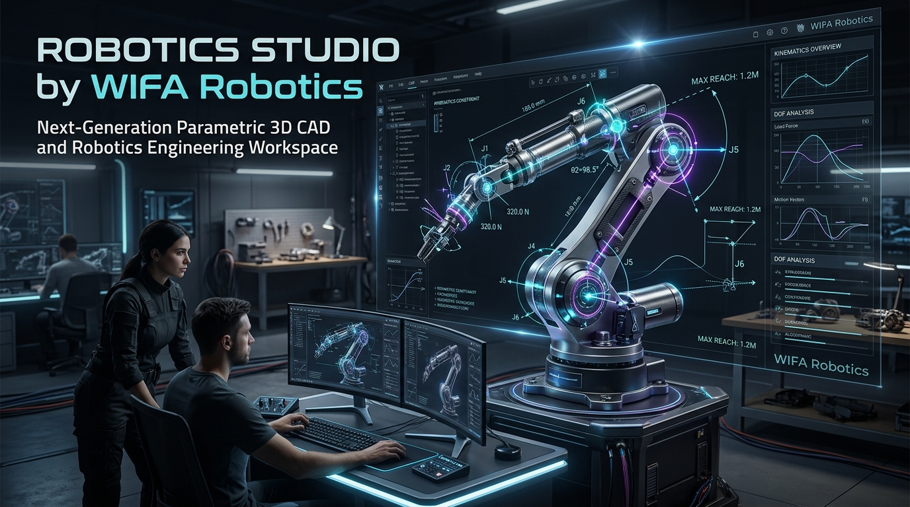
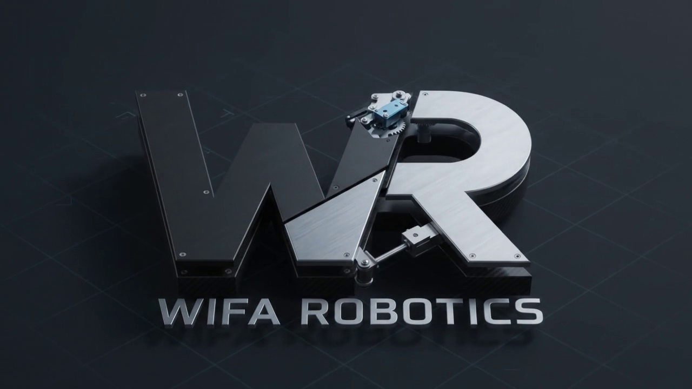

<p align="center">
  
</p>

<p align="center">
  
</p>

<h1 align="center">Robotics Studio</h1>

<p align="center">
  <strong>Next-Generation Parametric 3D CAD & Kinematic Robotics Engineering Platform</strong><br />
  <em>Engineered in Pure Rust by <strong>WIFA Robotics</strong></em>
</p>

<p align="center">
  <a href="https://github.com/williamfarokhzad/Robotics-Studio/releases/latest"></a>
  <a href="LICENSE-MIT"></a>
  <a href="#zero-crash-architecture"></a>
  <a href="#ai-agent-integration-mcp"></a>
  <a href="#robotics--kinematics"></a>
</p>

---

## 🚀 Overview

**Robotics Studio** is an open-source, high-performance parametric 3D CAD application and kinematic modeling environment designed from the ground up in pure **Rust**. Created by **WIFA Robotics**, it bridges precision mechanical engineering, sheet metal fabrication, and robotics simulation into a unified, crash-resilient workstation.

Whether you are designing multi-axis robotic arms, mobile rover chassis, mechanical linkage mechanisms, or precision 3D-printed enclosures, Robotics Studio gives you:
* **Parametric Feature Timeline:** Non-destructive modeling where modifying any dimension or expression cleanly rebuilds your design.
* **Robotics Simulation & URDF Pipelines:** Native kinematics, joint limits, motion studies, collision detection, and automated URDF export for Gazebo, ROS 2, and NVIDIA Isaac Sim.
* **AI-Agent Operability (MCP):** A built-in Model Context Protocol server enabling LLMs and autonomous agents to design, modify, and inspect CAD models directly via structured commands.
* **Zero-Crash Architecture:** Written under `#![deny(clippy::unwrap_used, clippy::panic)]`—protecting human designs and autonomous agent loops from unexpected crashes.

---

## 🛠️ Key Capabilities

### 1. 🤖 Robotics & Kinematic Assemblies
* **Kinematic Joints:** Rigid, Revolute, Slider, Cylindrical, Pin-Slot, Planar, and Ball joints with mechanical limits and live joint drivers.
* **Closed Kinematic Loops:** Automated solving for 4-bar linkages, crank-slider mechanisms, and cam-follower systems.
* **Motion Studies & Collision Sets:** Animate joint sequences along keyframed timelines, chart velocities and accelerations, and detect physical interferences in real-time.
* **URDF Export:** Direct generation of unified robot descriptions with exact inertial tensors, centers of mass, and collision/visual meshes.

### 2. 📐 Parametric CAD & Constraint Solver
* **Sketches with Solver:** Lines, arcs, splines, ellipses, slots, conic curves, and dimensions solved deterministically by our custom geometric constraint solver.
* **3D Solid Operations:** Extrude (one-side, two-sided, symmetric, to object), Revolve, Sweep along 3D curves, Multi-section Loft with guide rails, Fillets & Chamfers, Shell, Draft, Holes, and Modelled Threads.
* **Persistent Topological Naming:** Advanced tracking of face and edge lineages so downstream features stay intact through dimension shifts and parameter changes.
* **Unit-Aware Expressions:** Full mathematical expression evaluator (`d1 * 2 + sin(angle)`) with cyclical dependency graph detection.

### 3. 🏭 Sheet Metal & Enclosures
* **Sheet Metal Fabrication:** Base and edge flanges, contour flanges, hem joins, and real-time fold/unfold.
* **Flat Pattern & DXF Output:** Calculate K-factors, bend deductions, and produce accurate 2D DXF files for laser cutting and CNC bending machines.
* **Plastic Design Features:** Built-in tools for mounting bosses, strengthening ribs, web gussets, lip/groove seals, and snap-fit joints.

### 4. 🧠 Autonomous AI Modeling (MCP Server)
Robotics Studio features native **Model Context Protocol (MCP)** integration. AI coding assistants (such as Claude Code, Cursor, Antigravity, and custom LLM agents) can drive the modeling engine programmatically:
```sh
# Start the headless MCP server for AI agent pairing
robotics-studio mcp
```

### 5. 🔄 Interoperability & File Support
* **Standard Formats:** Import & export STEP (AP203/AP214/AP242), IGES, 3MF with B-rep face tags, STL, OBJ, glTF 2.0, DXF, and SVG.
* **Direct Import:** Read native FreeCAD (`.FCStd`) and Rhino (`.3dm`) solid files.

---

## 🏛️ System Architecture

Robotics Studio follows an uncompromised layered architecture (`cargo xtask layers` enforced):

| Layer | Crates | Functionality |
|:---|:---|:---|
| **L0** | `geom` | Vectors, transforms, planes, analytical profiles, boundary meshes, and spatial measurements. |
| **L1** | `sketch`, `kernel`, `render` | 2D/3D geometric constraint solver; B-rep boundary representation; camera math and headless scene graphs. |
| **L2** | `doc` | Parametric variables, expression evaluator, feature timeline, and incremental re-computation. |
| **L3** | `io` | Native `.solidcraft` containers, industrial STEP/IGES/3MF/DXF codecs, and mesh converters. |
| **L4** | `engine` | Command pattern registry (`Session::execute`), kinematic solver, and transaction state. |
| **L5** | `gpu`, `ui-egui`, `mcp` | WGPU rendering pipelines, immediate-mode GUI, and Model Context Protocol server. |
| **Apps**| `solidcraft`, `solidcraft-cli`, `solidcraft-web` | Desktop application (Windows/macOS/Linux), headless CLI, and in-browser WebAssembly. |

---

## ⚡ Quickstart & Building

### Prerequisites
* Rust 1.85+ (Edition 2024)
* A graphics driver supporting Vulkan, DirectX 12, or Metal

### Build Desktop Application
```bash
# Clone the repository
git clone https://github.com/williamfarokhzad/Robotics-Studio.git
cd Robotics-Studio

# Launch the desktop studio with a sample model
cargo run --release -p solidcraft -- --sample

# Run the headless command-line interface
cargo run --release -p solidcraft-cli -- commands
```

### Quality & Safety Verification
```bash
# Run the complete test suite, formatting, Clippy lints, and architecture layer audit
cargo xtask ci
```

---

## 📄 License & Attribution

Robotics Studio is an independent project authored and maintained by **WIFA Robotics**.
Licensed under either of:
* **MIT License** ([LICENSE-MIT](LICENSE-MIT))
* **Apache License, Version 2.0** ([LICENSE-APACHE](LICENSE-APACHE))

*All third-party libraries and dependencies are strictly open-source (MIT / Apache-2.0 / BSD) and documented in [ATTRIBUTION.md](ATTRIBUTION.md) and [NOTICE](NOTICE).*
